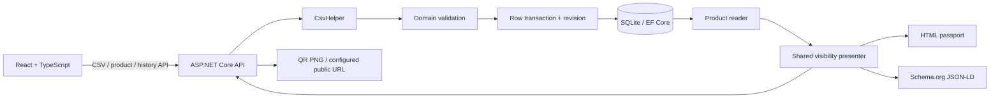

# Mini DPP

A focused Digital Product Passport application for the ESG Next assessment. Upload
a CSV, inspect validation errors, and share a product's HTML passport, schema.org
JSON-LD or downloadable QR code. Includes both bonuses: a responsive React interface
and immutable version history.

The [original specification](docs/Mini_DPP_Teknik_Odev_ESG_Next.pdf) and
[unchanged sample CSV](samples/urunler_duzeltilmis_test.csv) are included.
See the [acceptance checklist and verification record](docs/REVIEW.md) and
[incremental commit plan](docs/COMMITS.md).

## Quick start

Prerequisites: **.NET 10 LTS SDK**, **Node.js 24 or later** (24 LTS recommended), npm,
and Git. No database server, account, secrets or cloud services are needed.

From the repository root, start the backend:

```sh
dotnet restore backend/MiniDpp.sln --locked-mode
dotnet run --project backend/src/MiniDpp.Api
```

In a second terminal:

```sh
cd frontend
npm ci
npm run dev
```

Open **http://localhost:5173**. API: http://localhost:5080.
Swagger UI: http://localhost:5080/swagger (Development environment only).
The backend applies checked-in EF Core migrations on startup and creates
`backend/src/MiniDpp.Api/mini-dpp.db` when run using the command above.

For this prepared Windows workspace, .NET 10 was installed under ignored `.tools/`
because the system SDK is .NET 9. Run `. ./scripts/Use-WorkspaceDotnet.ps1` from
the root in a PowerShell terminal before using the commands above. A fresh clone
with the .NET 10 SDK installed does not need this helper or `.tools/`.

## Import the sample

1. Select **CSV import**, choose `samples/urunler_duzeltilmis_test.csv`, then
   **Validate & import**. Drag and drop is also supported.
2. The first import into an empty database returns **5 total, 3 imported, 0 updated,
   0 unchanged, 2 rejected**.
3. CSV **row 4** has no GTIN; **row 5** has fiber percentages totalling 98.
   Header is row 1. Other valid records are saved.
4. Open **Products**, search/filter the records, then open a passport. Use its
   authorized demo switch, output links, QR download and version timeline.
5. Repeat the same upload: **3 unchanged, 2 rejected**, with no new revisions.

Successful GTINs: `08690000000012`, `08690000000029`, `08690000000050`.
Never resave the sample through Excel: leading zeros may be lost. Its SHA-256 is
`A3C4189EA0EDB327A0E2EB67B6FEEBE0DF0370A96162B476C91285B458E7A107`.

Command-line upload (use `curl.exe` instead of `curl` in Windows PowerShell):

```sh
curl -F "file=@samples/urunler_duzeltilmis_test.csv" http://localhost:5080/api/import/csv
```

Response, abbreviated only within each row's error list:

```json
{
  "total": 5,
  "imported": 3,
  "updated": 0,
  "unchanged": 0,
  "failed": 2,
  "errors": [
    { "row": 4, "errors": [{ "field": "gtin", "message": "GTIN must contain exactly 14 ASCII digits with a valid GS1 check digit." }] },
    { "row": 5, "errors": [{ "field": "composition", "message": "Cotton and elastane percentages must sum to 100." }] }
  ]
}
```

## Architecture and data model

ASP.NET Core minimal endpoints delegate to small application services. Domain
validation has no framework dependency. Infrastructure contains CsvHelper, EF Core
and SQLite. DTOs are distinct from entities; no generic repository or global frontend
state framework is needed. React 19, TypeScript and Vite use a typed fetch client;
QRCoder generates PNGs; Swashbuckle provides OpenAPI.



| Table | Identity and responsibility |
| --- | --- |
| Models | Integer PK; unique trimmed, case-sensitive model name |
| Batches | Model FK; unique GTIN **text**; unique `(ModelId, Number)`; composition, location, carbon, current version, UTC timestamp |
| Revisions | Batch FK; unique `(BatchId, Version)`; complete immutable state including the model name and UTC timestamp |

**Composition belongs to the batch**, as do production location and carbon: two
lots of the same model can have different recipes or manufacturing footprints.
Model names are shared identities. Importing a changed name reassigns only that
GTIN to the named model; it never renames another batch's model. A model can remain
unreferenced after reassignment. A model/batch pair already assigned to another
GTIN is rejected rather than silently merged or overwritten.

Decimals are validated and compared using C# `decimal`; SQLite stores them as
invariant text to retain exact precision. Foreign keys, unique indexes, a version
concurrency token and GTIN/version check constraints reinforce application rules.

## Import and version semantics

- Input is comma-delimited **UTF-8**, with optional BOM. Required column names are
  exactly those in the sample; order may vary and extra unique columns are ignored.
- Text is trimmed. GTIN needs 14 ASCII digits and a GS1 Mod-10 check digit. Cotton
  and elastane each lie in [0,100] and sum to exactly 100. Carbon is nonnegative.
  Decimal separator is a dot; grouping separators and exponent notation are rejected.
- Blank physical lines are skipped but counted for error numbering. Quoted commas
  and multiline fields work; errors report the record's **starting physical line**.
  A delimiter-only record is a data row and is rejected by validation.
- Limits: **2 MiB**, **10,000 data rows**, **4,096 characters per parsed field**,
  200 characters for required descriptive text. Empty uploads, missing/duplicate
  headers, invalid encoding and parser resource-limit failures return Problem Details
  before writes. Recoverable malformed rows are rejected independently.
- Each valid row has one transaction spanning model, batch and revision. An invalid
  row or persistence conflict leaves no partial entities; subsequent rows continue.
  A fatal I/O/database error can stop a file after earlier committed rows. The error
  explains that an idempotent retry is safe. Cancellation rolls back the active row.
- GTIN is the update key. Normalized, identical values count as **unchanged**,
  including numerically equivalent decimals such as `12.4` and `12.40`.
  Repeated GTINs in one file are processed sequentially using the same rules.
- New GTINs get **version 1** and a snapshot. Each real change appends **N+1** and
  updates the current row in the same transaction. Older snapshots already contain
  the full prior state. Timestamps are UTC. Revision modification/deletion is blocked
  by the context; raw database administration is outside this application's boundary.

## API and examples

| Method | Endpoint | Result |
| --- | --- | --- |
| POST | `/api/import/csv` | Multipart `file`; independent-row import report |
| GET | `/api/products?q=denim` | Search model, GTIN, batch or location |
| GET | `/api/products/{gtin}` | Current filtered passport DTO |
| GET | `/api/products/{gtin}/history` | Filtered snapshots, newest first |
| GET | `/api/products/{gtin}/history/{version}` | One filtered snapshot |
| GET | `/dpp/{gtin}` | Human-readable HTML passport |
| GET | `/dpp/{gtin}.jsonld` | `application/ld+json`, schema.org Product |
| GET | `/dpp/{gtin}/qr.png` | Decodable `image/png` pointing to the consumer HTML URL |

Unknown products/versions return **404**. File-level validation returns **400**;
oversized files **413**; a non-multipart media type **415**. Row rejection is reported
inside the **200** partial-success report. Unexpected failures return safe **500**
Problem Details without stack traces or configuration. OpenAPI describes the routes,
query parameters, multipart upload and product/history schemas.

```sh
curl http://localhost:5080/api/products/08690000000012
curl "http://localhost:5080/api/products/08690000000012/history?rol=yetkili"
```

Consumer DTO (timestamp varies):

```json
{
  "gtin": "08690000000012",
  "modelName": "Slim Denim 501",
  "batchNumber": "B2027-01",
  "cotton": 98,
  "elastane": 2,
  "location": "Denizli",
  "version": 1,
  "updatedAt": "2026-11-04T09:00:00Z"
}
```

Try these while both development servers run:

- HTML: http://localhost:5173/dpp/08690000000012
- JSON-LD: http://localhost:5173/dpp/08690000000012.jsonld
- QR: http://localhost:5173/dpp/08690000000012/qr.png
- Authorized HTML: http://localhost:5173/dpp/08690000000012?rol=yetkili
- Authorized JSON-LD: http://localhost:5173/dpp/08690000000012.jsonld?rol=yetkili

JSON-LD uses [schema.org/Product](https://schema.org/Product) and
`additionalProperty` / `PropertyValue` for batch, percentages, location, version and
authorized carbon, with `unitText` where applicable. It invents no schema.org fields.

## Demo visibility and configuration

**`?rol=yetkili` is NOT real authorization.** Anyone can supply it. The assessment
excludes authentication; this application must not protect real sensitive records.
The shared presenter removes the carbon value entirely from consumer HTML,
JSON-LD, product APIs and historical snapshots. Consumer API objects omit
`carbonKgCo2e` rather than returning null. Authorized responses include it.
Switching roles discards previous React data and refetches both product and history.
Responses use `Cache-Control: no-store`. QR codes always encode a consumer URL.

Safe defaults live in `backend/src/MiniDpp.Api/appsettings.json`. ASP.NET environment
variables override them; `.env.example` files are references, not automatically loaded.

| Variable | Default / purpose |
| --- | --- |
| `PublicBaseUrl` | `http://localhost:5173`; trusted absolute HTTP(S) base for QR/HTML/JSON-LD links |
| `ConnectionStrings__Dpp` | Local SQLite file; foreign keys enabled |
| `CorsOrigins__0` | `http://localhost:5173`; explicitly allowed browser origin |
| `AllowedHosts` | `localhost;127.0.0.1`; configure explicitly for other hosts |
| `ASPNETCORE_URLS` | `http://localhost:5080` in the development launch profile |

Vite proxies `/api`, `/dpp` and `/swagger` to port 5080. Thus all output links work
through port 5173. If running **only the backend**, set `PublicBaseUrl` to
`http://localhost:5080`. QR generation never derives its URL from request Host or
forwarded headers. A phone requires a reachable LAN address and corresponding
listener/origin/host configuration; `localhost` on a phone refers to that phone.

## Database migrations

Startup applies migrations automatically for this local assessment. To apply manually,
from the root:

```sh
dotnet tool restore
dotnet ef database update --project backend/src/MiniDpp.Infrastructure --startup-project backend/src/MiniDpp.Api
```

To evolve the schema, edit the model then create a real migration:

```sh
dotnet ef migrations add DescribeChange --project backend/src/MiniDpp.Infrastructure --startup-project backend/src/MiniDpp.Api --output-dir Migrations
```

For a fresh demo, stop the API and delete **only** its local `mini-dpp.db` and matching
`mini-dpp.db-wal` / `mini-dpp.db-shm` files. Restart to recreate the schema.

## Tests and checks

From the root:

```sh
dotnet restore backend/MiniDpp.sln --locked-mode
dotnet build backend/MiniDpp.sln --no-restore --configuration Release
dotnet test backend/MiniDpp.sln --no-build --configuration Release
dotnet format backend/MiniDpp.sln --no-restore --verify-no-changes
```

From `frontend/`:

```sh
npm ci
npm run typecheck
npm run lint
npm run format:check
npm test
npm run build
npx playwright install chromium
npm run test:e2e
```

xUnit uses WebApplicationFactory with isolated real SQLite files and real migrations.
Tests cover the supplied sample, GS1, boundaries, decimals, malformed input, relational
integrity, injected snapshot failure/rollback, idempotency, revisions, all visibility
surfaces, HTML escaping, CORS, OpenAPI, 404s, and PNG decoding with ZXing.
Vitest/Testing Library cover importing, row errors, retry, loading, filtering and role
changes. Playwright drives the real API/UI, checks desktop/mobile layouts, scans
WCAG A/AA rules with axe, and validates passport links and response types.

Playwright starts both servers with an isolated temporary database when ports are
free. Outside CI it can reuse already running local servers, in which case its sample
import affects that local demo database. Stop both servers to test a fresh start.
GitHub Actions runs backend, frontend and browser jobs. Workflow execution itself
requires a future authorized commit/push; it has not been claimed as run remotely.

## Repository layout

```text
backend/
  src/MiniDpp.Domain/          # Entities and framework-free validation
  src/MiniDpp.Application/     # Contracts, importer/reader ports, visibility presenter
  src/MiniDpp.Infrastructure/  # EF Core, migrations, CsvHelper, transactions
  src/MiniDpp.Api/             # HTTP endpoints, HTML/JSON-LD/QR, OpenAPI
  tests/MiniDpp.Tests/         # xUnit unit + HTTP/SQLite integration tests
frontend/
  src/                        # Typed client, views, reusable UI and CSS
  tests/                      # Vitest/Testing Library and Playwright
samples/                      # Original unmodified CSV
docs/                         # Original PDF, plan, acceptance and commit guidance
scripts/                      # Optional local SDK helper
.github/workflows/ci.yml
```

## Trade-offs and limitations

- This is a local assessment app with no accounts, deployment, CSV export or cloud
  dependencies. Consumers have no write protection; CORS is not authorization.
- Model-name matching is trimmed and case-sensitive. GTIN represents one product
  batch in the supplied specification, not a broader cross-lot trade-item catalogue.
- SQLite is appropriate for this small workload. Concurrent import conflicts are
  rejected safely and can be retried; high-volume ingestion, distributed writers,
  pagination and database-side decimal analytics would need a different design.
- An unclosed quoted field can consume subsequent physical lines. Safe resynchronizing
  is ambiguous; it is rejected as one malformed logical record rather than guessing.
- Carbon validation errors identify fields/rules without echoing the source value.
  This is demo filtering, not a full data-classification or audit platform.
- Production serving of built React assets and reverse-proxy operations are outside
  the assessment. `npm run build` produces `frontend/dist`; the documented development
  proxy is the complete supported local setup. Docker was deliberately omitted.

No commits or pushes were made during implementation. Use the reviewable logical
changes in [docs/COMMITS.md](docs/COMMITS.md) to create your own real history after review.
