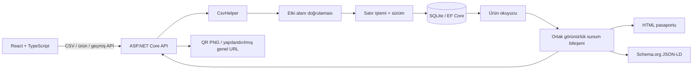

# Mini DPP

ESG Next teknik değerlendirmesi için geliştirilmiş bir Dijital Ürün Pasaportu
uygulamasıdır. CSV yükleyebilir, doğrulama hatalarını inceleyebilir ve ürünün HTML
pasaportunu, schema.org JSON-LD verilerini veya indirilebilir QR kodunu
paylaşabilirsiniz. İki bonus da uygulanmıştır: duyarlı React arayüzü ve
değiştirilemez sürüm geçmişi. Arayüz ve kullanıcıya gösterilen API/HTML iletileri
Türkçe ve İngilizcedir; ilk ziyarette varsayılan dil Türkçedir.

[Özgün şartname](docs/Mini_DPP_Teknik_Odev_ESG_Next.pdf) ve
[değiştirilmemiş örnek CSV](samples/urunler_duzeltilmis_test.csv) depodadır.
[Kabul listesi ve doğrulama kaydı](docs/REVIEW.md) ile
[doğrulanmış commit geçmişini](docs/COMMITS.md) inceleyebilirsiniz. PDF’nin herkese
açık dağıtımına ilişkin önceki inceleme notu [burada](docs/REVIEW.md) korunmuştur.

## Hızlı başlangıç

Gereksinimler: **.NET 10 LTS SDK**, **Node.js 24 veya üzeri** (24 LTS önerilir), npm
ve Git. Veritabanı sunucusu, hesap, gizli anahtar veya bulut hizmeti gerekmez.

Herkese açık depoyu klonlayın:

```sh
git clone https://github.com/GorkemErtas/mini-dpp-platform.git
cd mini-dpp-platform
```

`.gitattributes`, Windows ve Unix üzerinde LF satır sonlarını korur;
`core.autocrlf=true` olsa bile sağlanan CSV/PDF dosyalarının baytları değişmez.
Depo kökünden arka ucu başlatın:

```sh
dotnet restore backend/MiniDpp.sln --locked-mode
dotnet run --project backend/src/MiniDpp.Api
```

İkinci terminalde:

```sh
cd frontend
npm ci
npm run dev
```

**http://localhost:5173** adresini açın. API: http://localhost:5080.
Swagger UI: http://localhost:5080/swagger; yalnızca `Development` ortamında açıktır.
Arka uç, depodaki EF Core migration dosyalarını başlangıçta uygular. Bu komutla
çalıştırıldığında `backend/src/MiniDpp.Api/mini-dpp.db` oluşturulur.

Bu hazırlanmış Windows çalışma alanında sistem SDK’sı .NET 9 olduğu için .NET 10,
yok sayılan `.tools/` altında kuruludur. PowerShell’de depo kökünden önce
`. ./scripts/Use-WorkspaceDotnet.ps1` çalıştırın. .NET 10 SDK kurulu yeni bir klonda
bu yardımcıya veya `.tools/` dizinine gerek yoktur.

## Örnek veriyi içe aktarma

1. **CSV İçe Aktarma** sayfasında `samples/urunler_duzeltilmis_test.csv` dosyasını
   seçip **Doğrula ve İçe Aktar** düğmesine basın. Sürükleyip bırakma desteklenir.
2. Boş veritabanına ilk yükleme: **5 toplam, 3 içe aktarılan, 0 güncellenen,
   0 değişmeyen, 2 reddedilen** satır.
3. CSV’nin **4. satırında** GTIN yoktur; **5. satırında** elyaf yüzdelerinin toplamı
   98’dir. Başlık 1. satırdır. Diğer geçerli kayıtlar kaydedilir.
4. **Ürünler** sayfasında arama/filtreleme yapıp pasaport açın. Yetkili demo
   anahtarını, çıktı bağlantılarını, QR indirmeyi ve sürüm zaman çizelgesini deneyin.
5. Aynı dosyayı tekrar yükleyin: **3 değişmeyen, 2 reddedilen**; yeni sürüm oluşmaz.

Başarılı GTIN’ler: `08690000000012`, `08690000000029`, `08690000000050`.
Örneği Excel’de yeniden kaydetmeyin; baştaki sıfırlar kaybolabilir. SHA-256:
`A3C4189EA0EDB327A0E2EB67B6FEEBE0DF0370A96162B476C91285B458E7A107`.

Komut satırından yükleme; Windows PowerShell’de `curl` yerine `curl.exe` kullanın:

```sh
curl -F "file=@samples/urunler_duzeltilmis_test.csv" http://localhost:5080/api/import/csv
```

Her satırın hata listesi kısaltılmış örnek yanıt:

```json
{
  "total": 5,
  "imported": 3,
  "updated": 0,
  "unchanged": 0,
  "failed": 2,
  "errors": [
    { "row": 4, "errors": [{ "field": "gtin", "message": "GTIN, geçerli bir GS1 kontrol basamağı içeren tam 14 ASCII rakamından oluşmalıdır." }] },
    { "row": 5, "errors": [{ "field": "composition", "message": "Pamuk ve elastan yüzdelerinin toplamı 100 olmalıdır." }] }
  ]
}
```

## Dil seçimi ve yerelleştirme

Üst gezinmedeki **TR | EN** düğmeleri dili sayfa yenilemeden değiştirir. Etkin dil
`aria-pressed` ile belirtilir. Düğmeler klavye ile kullanılabilir; dokunma alanları
en az 44 × 44 CSS pikseldir. Seçim, `localStorage` içindeki `mini-dpp-language`
anahtarında saklanır; gezinme ve yenilemede korunur. Saklama engellenirse dil
değiştirme yine çalışır. `html lang`, sayfa başlığı/açıklaması, erişilebilirlik
metinleri ve durum iletileri güncellenir.

`frontend/src/i18n/en.ts` ve `tr.ts` merkezi, tipli arayüz sözlükleridir. TypeScript
eksik/yanlış anahtarları, testler de yer tutucu eşleşmelerini denetler. `index.ts`,
React’in `useSyncExternalStore` işleviyle aboneliği ve kalıcılığı yönetir; ek paket
yoktur. Tarihler UTC korunarak `tr-TR` / `en-US`, sayılar `Intl` ile biçimlendirilir.
GTIN, kullanıcı verisi ve depolanan sayılar değişmez. CSV ondalık ayırıcısı her iki
dilde de **nokta**dır.

Her React API isteği güncel `Accept-Language: tr` veya `en` başlığını gönderir.
Başlık yoksa veya desteklenen dil bulunmazsa varsayılan Türkçedir. Bölgesel dil
eşleştirmesi ve kalite ağırlıkları desteklenir; yanıtta `Content-Language` bulunur.
`localization/server-messages.json`, API ile React’in ortak hata sözlüğüdür ve API
derlemesine gömülür. Doğrulama ve istisna metinleri yalnızca HTTP sunumunda çevrilir;
iş kuralları ve günlükler korunur. Ekranda tutulan içe aktarma hataları dil değişince
yeniden çevrilir; dosya yeniden gönderilmez.

Bağımsız HTML pasaportu **`?lang=tr` / `?lang=en`** destekler. Geçerli `lang`, yalnızca
`/dpp` yollarında başlıktan önceliklidir; sonra `Accept-Language` ve Türkçe varsayılanı
uygulanır. React’in HTML bağlantısı seçili dili taşır. HTML’deki Türkçe/English
bağlantıları demo rolünü korur. Doğrudan tarayıcı gezintisi de çalışır; sunucu
React’in `localStorage` değerini okuyamaz.

```sh
curl -H "Accept-Language: en" -F "file=@samples/urunler_duzeltilmis_test.csv" http://localhost:5080/api/import/csv
curl "http://localhost:5080/dpp/08690000000012?lang=tr"
curl "http://localhost:5080/dpp/08690000000012?lang=en&rol=yetkili"
```

JSON alanları, CSV sütunları, API yolları, `rol=yetkili`, schema.org sözlüğü ve
JSON-LD `PropertyValue` adları sabittir. QR, her dilde aynı tüketici URL’sidir;
hedefine `lang` veya yetkili rolü eklenmez. QR ile açılan HTML, tarayıcının
`Accept-Language` başlığını veya Türkçe varsayılanını kullanır. Swagger/OpenAPI’nin
geliştiriciye yönelik teknik açıklamaları ve özgün ürün verileri çevrilmez.

## Mimari ve veri modeli

ASP.NET Core minimal uç noktaları küçük uygulama servislerine yönlendirir. Etki
alanı doğrulaması framework bağımlılığı içermez. Altyapıda CsvHelper, EF Core ve
SQLite bulunur. DTO’lar varlıklardan ayrıdır; genel amaçlı repository veya küresel
ön uç durum yönetim framework’ü gerekmez. React 19, TypeScript ve Vite tipli fetch
istemcisi kullanır; QRCoder PNG, Swashbuckle OpenAPI üretir.



| Tablo | Kimlik ve sorumluluk |
| --- | --- |
| Models | Tamsayı PK; kırpılmış, büyük/küçük harfe duyarlı benzersiz model adı |
| Batches | Model FK; benzersiz **metin** GTIN; benzersiz `(ModelId, Number)`; bileşim, yer, karbon, güncel sürüm, UTC zamanı |
| Revisions | Batch FK; benzersiz `(BatchId, Version)`; model adı ve UTC zamanı dâhil tam, değiştirilemez durum |

**Bileşim partiye aittir**; üretim yeri ve karbon da öyledir. Aynı modelin iki
partisinde farklı reçete ve üretim ayak izi bulunabilir. Model adları ortak
kimliklerdir. Adı değişen kaydın içe aktarılması yalnızca o GTIN’i ilgili modele
bağlar; başka partinin modelini yeniden adlandırmaz. Sonrasında referanssız model
kalabilir. Başka GTIN’e atanmış model/parti çifti sessizce birleştirilmez veya üzerine
yazılmaz; satır reddedilir.

Ondalıklar C# `decimal` ile doğrulanıp karşılaştırılır. SQLite, tam hassasiyeti
korumak için kültürden bağımsız metin saklar. Yabancı anahtarlar, benzersiz indeksler,
sürüm eş zamanlılık belirteci ve GTIN/sürüm kontrol kısıtları kuralları destekler.

## İçe aktarma ve sürüm kuralları

- Girdi virgülle ayrılmış **UTF-8** CSV’dir; BOM isteğe bağlıdır. Zorunlu sütun adları
  örnektekiyle aynıdır. Sıra değişebilir; ek benzersiz sütunlar yok sayılır.
- Metinler kırpılır. GTIN 14 ASCII rakamı ve GS1 Mod-10 kontrol basamağı gerektirir.
  Pamuk/elastan ayrı ayrı [0,100] aralığında ve toplam tam 100 olmalıdır. Karbon
  negatif olamaz. Ondalık ayırıcı noktadır; binlik ayırıcı ve üstel gösterim reddedilir.
- Boş fiziksel satırlar atlanır; hata numarasında sayılır. Tırnaklı virgül ve çok
  satırlı alanlar desteklenir. Hata, kaydın **başladığı fiziksel satırı** gösterir.
  Yalnızca ayırıcılardan oluşan kayıt veri satırıdır ve doğrulamada reddedilir.
- Sınırlar: **2 MiB**, **10.000 veri satırı**, alan başına **4.096 karakter**, zorunlu
  açıklama metninde 200 karakter. Boş dosya, eksik/yinelenen başlık, geçersiz kodlama
  ve ayrıştırıcı kaynak sınırı hataları yazma öncesinde Problem Details döndürür.
  Kurtarılabilir hatalı satırlar bağımsız reddedilir.
- Her geçerli satırda model, parti ve sürümü kapsayan tek transaction vardır.
  Geçersiz satır veya kalıcılık çakışması kısmi varlık bırakmaz; sonraki satırlar
  sürer. Ölümcül G/Ç veya veritabanı hatası önceden kaydedilmiş satırlardan sonra
  dosyayı durdurabilir. Hata, idempotent tekrarın güvenli olduğunu açıklar. İptal,
  etkin satır işlemini geri alır.
- Güncelleme anahtarı GTIN’dir. Normalize edilmiş aynı değerler **değişmeyen**
  sayılır; `12.4` ve `12.40` gibi sayısal eşdeğerler buna dâhildir. Dosya içindeki
  yinelenen GTIN’ler aynı kurallarla sırayla işlenir.
- Yeni GTIN, **sürüm 1** ve tam durum kaydı alır. Gerçek değişiklik, **N+1** sürümünü
  ekleyip güncel satırı aynı transaction içinde değiştirir. Eski kayıtlar önceki
  tam durumu içerir. Zamanlar UTC’dir. Context, geçmiş kayıtların değiştirilmesini
  ve silinmesini engeller; doğrudan veritabanı yönetimi uygulama sınırının dışındadır.

## API ve örnekler

| Yöntem | Uç nokta | Sonuç |
| --- | --- | --- |
| POST | `/api/import/csv` | Multipart `file`; bağımsız satırlı içe aktarma raporu |
| GET | `/api/products?q=denim` | Model, GTIN, parti veya yer araması |
| GET | `/api/products/{gtin}` | Süzülmüş güncel pasaport DTO’su |
| GET | `/api/products/{gtin}/history` | En yeni önce olacak şekilde süzülmüş sürümler |
| GET | `/api/products/{gtin}/history/{version}` | Tek, süzülmüş sürüm |
| GET | `/dpp/{gtin}` | İnsan tarafından okunabilir HTML pasaportu |
| GET | `/dpp/{gtin}.jsonld` | `application/ld+json`, schema.org Product |
| GET | `/dpp/{gtin}/qr.png` | Tüketici HTML URL’sine yönlenen, çözümlenebilir `image/png` |

Bilinmeyen ürün/sürüm **404**, dosya doğrulaması **400**, fazla büyük dosya **413**,
multipart olmayan içerik türü **415** döndürür. Reddedilen satırlar **200** kısmi
başarı raporundadır. Beklenmeyen hatalar yığın izi veya yapılandırma içermeyen
güvenli **500** Problem Details yanıtlarıdır. OpenAPI; yolları, sorgu parametrelerini,
multipart yüklemeyi ve ürün/geçmiş şemalarını açıklar.

```sh
curl http://localhost:5080/api/products/08690000000012
curl "http://localhost:5080/api/products/08690000000012/history?rol=yetkili"
```

Tüketici DTO’su; zaman damgası değişebilir:

```json
{
  "gtin": "08690000000012",
  "modelName": "Slim Denim 501",
  "batchNumber": "B2027-01",
  "cotton": 98,
  "elastane": 2,
  "location": "Denizli",
  "version": 1,
  "updatedAt": "2026-11-04T09:00:00Z"
}
```

İki geliştirme sunucusu da çalışırken deneyin:

- HTML: http://localhost:5173/dpp/08690000000012
- Türkçe HTML: http://localhost:5173/dpp/08690000000012?lang=tr
- İngilizce HTML: http://localhost:5173/dpp/08690000000012?lang=en
- JSON-LD: http://localhost:5173/dpp/08690000000012.jsonld
- QR: http://localhost:5173/dpp/08690000000012/qr.png
- Yetkili HTML: http://localhost:5173/dpp/08690000000012?rol=yetkili
- Yetkili JSON-LD: http://localhost:5173/dpp/08690000000012.jsonld?rol=yetkili

JSON-LD, [schema.org/Product](https://schema.org/Product) ile parti, yüzdeler, yer,
sürüm ve yetkili karbon için `additionalProperty` / `PropertyValue` kullanır.
Uygun alanlarda `unitText` bulunur; yeni schema.org alanı uydurulmaz.

## Demo görünürlüğü ve yapılandırma

**`?rol=yetkili` gerçek yetkilendirme DEĞİLDİR.** Herkes ekleyebilir. Değerlendirme
kimlik doğrulamayı kapsam dışı bırakır; gerçek hassas kayıtları korumak için
kullanılmamalıdır. Ortak sunum bileşeni, karbonu tüketici HTML, JSON-LD, ürün API’si ve
geçmişten tamamen çıkarır. Tüketici nesnesinde `carbonKgCo2e` null olarak dönmez;
alan yoktur. Yetkili yanıtta bulunur. Rol değişince React önceki veriyi atar, ürün
ve geçmişi yeniden getirir. Yanıtlar `Cache-Control: no-store` kullanır. QR daima
tüketici URL’sini kodlar.

Varsayılanlar `backend/src/MiniDpp.Api/appsettings.json` içindedir. ASP.NET ortam
değişkenleri bunları geçersiz kılar. `.env.example` dosyaları otomatik yüklenmez.

| Değişken | Varsayılan / amaç |
| --- | --- |
| `PublicBaseUrl` | `http://localhost:5173`; QR/HTML/JSON-LD için güvenilir mutlak HTTP(S) tabanı |
| `ConnectionStrings__Dpp` | Yerel SQLite dosyası; yabancı anahtarlar etkin |
| `CorsOrigins__0` | `http://localhost:5173`; açıkça izin verilen tarayıcı kaynağı |
| `AllowedHosts` | `localhost;127.0.0.1`; diğer sunucu adları için açıkça yapılandırın |
| `ASPNETCORE_URLS` | Geliştirme başlatma profilinde `http://localhost:5080` |

Vite, `/api`, `/dpp` ve `/swagger` yollarını 5080’e vekiller; çıktı bağlantıları
5173 üzerinden çalışır. **Yalnızca arka uç** çalışıyorsa `PublicBaseUrl` değerini
`http://localhost:5080` yapın. QR URL’si isteğin Host veya yönlendirme başlıklarından
üretilmez. Telefon için erişilebilir LAN adresi ile uygun dinleyici/kaynak/sunucu
adı ayarı gerekir; telefondaki `localhost`, telefonun kendisidir.

## Veritabanı migration işlemleri

Yerel değerlendirmede migration işlemleri başlangıçta otomatik uygulanır.
Depo kökünden elle uygulamak için:

```sh
dotnet tool restore
dotnet ef database update --project backend/src/MiniDpp.Infrastructure --startup-project backend/src/MiniDpp.Api
```

Şemayı geliştirmek için modeli düzenleyip gerçek bir migration oluşturun:

```sh
dotnet ef migrations add DescribeChange --project backend/src/MiniDpp.Infrastructure --startup-project backend/src/MiniDpp.Api --output-dir Migrations
```

Sıfırdan demo için API’yi durdurun; **yalnızca** yerel `mini-dpp.db` ve eşleşen
`mini-dpp.db-wal` / `mini-dpp.db-shm` dosyalarını silin. Yeniden başlayınca şema oluşur.
Yerelleştirme için şema değişikliği veya yeni migration eklenmemiştir.

## Testler ve kontroller

Depo kökünden:

```sh
dotnet restore backend/MiniDpp.sln --locked-mode
dotnet build backend/MiniDpp.sln --no-restore --configuration Release
dotnet test backend/MiniDpp.sln --no-build --configuration Release
dotnet format backend/MiniDpp.sln --no-restore --verify-no-changes
```

`frontend/` içinden:

```sh
npm ci
npm run typecheck
npm run lint
npm run format:check
npm test
npm run build
npx playwright install chromium
npm run test:e2e
```

xUnit, WebApplicationFactory ile yalıtılmış gerçek SQLite dosyalarını ve migration
işlemlerini kullanır. Örnek, GS1, sınırlar, ondalıklar, hatalı girdiler, ilişkisel
bütünlük, zorlanan sürüm hatası/geri alma, idempotent davranış, sürümler, tüm
görünürlük yüzeyleri, HTML kaçışları, CORS, OpenAPI, 404 ve ZXing ile PNG çözümleme
kapsanır. Yerelleştirme testleri varsayılan/başlık/sorgu seçimini, iki dilde doğrulama
ve güvenli hataları, doğrudan HTML’i ve verinin değişmemesini denetler.

Vitest/Testing Library; yükleme, satır hataları, tekrar deneme, yüklenme, filtreler,
rol değişimi, sözlük tamlığı, kalıcılık, gezinme, tarih/sayı biçimleri ve klavyeyle
dil seçimini sınar. Playwright gerçek API/arayüzü sürer; masaüstü/mobil taşma, axe
WCAG A/AA, çıktı bağlantıları, yanıt türleri ve yenileme sonrası dil kalıcılığını
denetler. Node 26’nın yerel `localStorage` özelliği DOM testlerinde jsdom’un
tarayıcı depolamasıyla değiştirilir.

Portlar boşsa Playwright iki sunucuyu ve yalıtılmış geçici veritabanını başlatır.
CI dışında açık sunucuları tekrar kullanabilir; örnek yükleme o demo veritabanını
etkiler. Temiz başlangıç için iki sunucuyu durdurun. GitHub Actions arka uç, ön uç
ve tarayıcı işleri içerir. Önceden yayımlanan
`b5f86b8a022c3f88b189acac3abfd3fa1d8dd966` için
[1 numaralı çalışma](https://github.com/GorkemErtas/mini-dpp-platform/actions/runs/41825678774)
başarılıdır; üç işin sonucu 2026-11-05 tarihinde GitHub aracıyla yeniden
doğrulanmıştır. Bu sonuç yerel yerelleştirme değişikliklerini kapsamaz. Güncel yerel
sonuçlar [REVIEW.md](docs/REVIEW.md), diğer uzak çalışmalar
[Actions sayfasındadır](https://github.com/GorkemErtas/mini-dpp-platform/actions).

## Depo düzeni

```text
backend/
  src/MiniDpp.Domain/          # Varlıklar ve framework bağımsız doğrulama
  src/MiniDpp.Application/     # Sözleşmeler, içe aktarma/okuma arayüzleri, görünürlük
  src/MiniDpp.Infrastructure/  # EF Core, migration, CsvHelper, transaction işlemleri
  src/MiniDpp.Api/             # HTTP, yerelleştirme, HTML/JSON-LD/QR, OpenAPI
  tests/MiniDpp.Tests/         # xUnit birim ve HTTP/SQLite bütünleştirme testleri
frontend/
  src/                        # Tipli istemci, görünümler, ortak arayüz ve CSS
  src/i18n/                   # Tipli Türkçe/İngilizce sözlükler ve dil durumu
  tests/                      # Vitest/Testing Library ve Playwright
localization/                 # API ile React’in ortak kullanıcı hataları
samples/                      # Özgün, değiştirilmemiş CSV
docs/                         # Özgün PDF, plan, kabul kaydı ve doğrulanmış geçmiş
scripts/                      # İsteğe bağlı yerel SDK yardımcısı
.github/workflows/ci.yml
```

## Tercihler ve sınırlamalar

- Yerel değerlendirme uygulamasıdır; hesaplar, dağıtım, CSV dışa aktarma ve bulut
  bağımlılıkları yoktur. Tüketici yazma koruması bulunmaz; CORS yetkilendirme değildir.
- Model adları kırpılır, büyük/küçük harfe duyarlıdır. Verilen şartnamede GTIN tek
  ürün partisini temsil eder; partiler üstü geniş bir ticari ürün kataloğunu değil.
- SQLite küçük yük için uygundur. Eş zamanlı çakışmalar güvenle reddedilip yeniden
  denenebilir. Yoğun aktarım, dağıtık yazıcılar, sayfalama ve veritabanında ondalık
  analizi farklı tasarım gerektirir.
- Kapatılmamış tırnaklı alan sonraki fiziksel satırları tüketebilir. Güvenli yeniden
  eşleme belirsizdir; tahmin yerine tek hatalı mantıksal kayıt olarak reddedilir.
- Karbon doğrulaması kaynak değeri tekrar etmeden alanı/kuralı belirtir. Demo
  süzmesidir; kapsamlı veri sınıflandırma veya denetim platformu değildir.
- Derlenmiş React dosyalarını üretimde sunma ve ters vekil işletimi kapsam dışıdır.
  `npm run build`, `frontend/dist` üretir. Belgelenen geliştirme vekili desteklenen
  tam yerel kurulumdur. Docker bilinçli olarak eklenmemiştir.

Yerel başlangıç HEAD’i `c624a7315c8af246643a52fa0cb033cdd3745a53` olarak doğrulanmıştır.
Başlangıç commit’i, dokuz uygulama/test/belge/CI commit’i ve inceleme düzeltmesi
[docs/COMMITS.md](docs/COMMITS.md) içindedir. Yerelleştirme başlangıçta inceleme için
commit edilmeden bırakılmış; kullanıcının sonraki açık talebiyle backend ve ilgili
testleri, frontend ve ilgili testleri, Türkçe belgeler olarak ayrı commit’lere
ayrılmıştır. Önceki commit’ler ve tarihleri değiştirilmemiştir.
